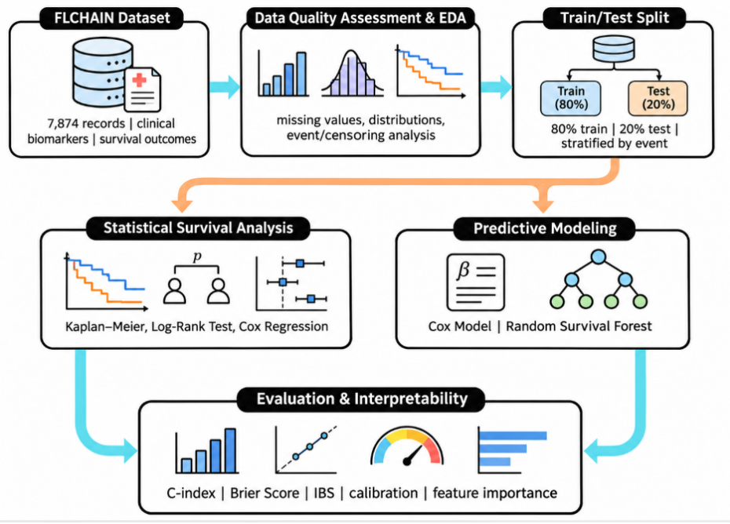

<!-- SurvLens | CAI401 · Selected Topics 2 -->

# SurvLens

### Survival Analysis & Prediction Using the FLCHAIN Dataset

**Turning censored clinical data into interpretable survival insights.**

  
  
  
  

**7,874 observations** · **8 predictors** · **2 predictive models** · **5-fold cross-validation**

[Overview](#-overview) · [Workflow](#-analytical-workflow) · [Results](#-model-performance) · [Run in Colab](#-run-the-project) · [Team](#-project-team)

---

## ✨ Overview

**SurvLens** is an academic healthcare analytics project that combines statistical survival analysis and machine learning to investigate **overall survival** using the **FLCHAIN (Free Light Chains)** dataset.

Unlike conventional classification, survival analysis considers **when** an event occurs and accounts for **right-censored observations**, where death was not observed during the available follow-up period.

The project studies survival patterns, explores associations between demographic/clinical factors and mortality, and compares two approaches to time-to-event prediction:

- **Cox Proportional Hazards Regression** - an interpretable, semi-parametric survival model.
- **Random Survival Forest (RSF)** - a tree-based ensemble that can model nonlinear relationships and feature interactions.

> **Research question:** Does the added flexibility of Random Survival Forest meaningfully improve survival prediction over an interpretable Cox model on FLCHAIN?

## 📊 Dataset at a Glance

| Property | FLCHAIN dataset |
|:--|:--|
| Observations | **7,874** |
| Observed deaths | **2,169 (27.55%)** |
| Right-censored observations | **5,705 (72.45%)** |
| Prediction target | Overall survival: follow-up time (days) and observed death status |
| Predictors used | Age, sex, creatinine, kappa, lambda, free light chain group, MGUS status, sample year |
| Missingness | **1,350** missing creatinine measurements (**17.15%**) |

The original dataset has nine explanatory variables. We **exclude `chapter` (cause-of-death classification)** from predictive modeling because it contains post-outcome information and could cause **data leakage**. All eight remaining predictors are retained.

The data are accessed programmatically using `sksurv.datasets.load_flchain()`; no separate manual dataset download is required.

## 🔄 Analytical Workflow

  

**Methodological Note:** We used an 80/20 stratified train–test split and five-fold cross-validation, with preprocessing fitted exclusively on training data to prevent data leakage.

## 🧠 Methods & Capabilities

| Component | What it provides |
|:--|:--|
| **Exploratory data analysis** | Clinical distributions, follow-up patterns, missingness, censoring |
| **Kaplan–Meier estimation** | Overall and grouped survival curves |
| **Log-rank tests** | Unadjusted survival comparisons across age, sex, and MGUS groups |
| **Descriptive Cox regression** | Hazard ratios, confidence intervals, proportional-hazards diagnostics |
| **Predictive Cox & RSF** | Risk scores and individual survival probability estimates |
| **Model evaluation** | Harrell's C-index, time-dependent Brier Score, Integrated Brier Score |
| **Interpretability** | Cox coefficients and RSF permutation feature importance |
| **Risk analysis** | Illustrative 1-, 3-, and 5-year survival estimates; relative risk groups |
| **Calibration** | Three-year predicted vs. observed survival comparisons |

## 🏆 Model Performance

The predictive models were evaluated on the **same held-out test set (1,575 observations)**.

| Metric | Cox Regression | Random Survival Forest |
|:--|--:|--:|
| Training C-index | 0.7974 | 0.8263 |
| 5-fold CV C-index (mean) | **0.7953** | 0.7891 |
| Held-out test C-index ↑ | 0.7979 | **0.7986** |
| Test Integrated Brier Score ↓ | **0.0812** | 0.0818 |

**Interpretation:** The models achieved **nearly identical held-out discrimination**, differing by only **0.0007** in test C-index. Cox showed a slightly lower Integrated Brier Score and more consistent training/validation discrimination; RSF showed a larger train–test gap. The uncertainty of these small performance differences was **not quantified**, so they should not be interpreted as proof that one model is universally superior.

### Key Findings

1. **Age was the strongest predictor** across the descriptive Cox analysis and RSF permutation importance.
2. **Kappa and lambda free light chains** showed associations with mortality hazard in the descriptive multivariable Cox analysis.
3. **Survival differed by age and MGUS status** in unadjusted log-rank comparisons; the sex comparison did not meet the 0.05 significance threshold.
4. **Both models overestimated three-year survival** in their respective groups with the lowest predicted survival probabilities, emphasizing the importance of calibration.
5. **Extra model complexity did not produce a substantial predictive gain** over Cox on this particular dataset.

## 🚀 Run the Project

The repository contains **three numbered Jupyter notebooks**, designed to run in sequence in **Google Colab**.

| Step | Notebook | Open in Colab |
|:--|:--|:--|
| **01** · Data preprocessing & EDA | [01_FLCHAIN_Data_Preprocessing_EDA_.ipynb](01_FLCHAIN_Data_Preprocessing_EDA_.ipynb) |  |
| **02** · Kaplan–Meier, log-rank & descriptive Cox | [02_FLCHAIN_Survival_Analysis_Cox_.ipynb](02_FLCHAIN_Survival_Analysis_Cox_.ipynb) |  |
| **03** · Predictive models & evaluation | [03_FLCHAIN_ML_Models_Evaluation_.ipynb](03_FLCHAIN_ML_Models_Evaluation_.ipynb) |  |

**Recommended execution order**

1. Run **Notebook 01**. It loads FLCHAIN, prepares the data, creates the stratified train/test split, and exports **`flchain_shared_data.zip`**.
2. Run **Notebook 02** for Kaplan–Meier curves, log-rank tests, Cox hazard ratios, and proportional-hazards diagnostics.
3. Run **Notebook 03** for Cox/RSF training, cross-validation, test evaluation, calibration, and interpretability.

> **Colab tip:** If you open Notebook 02 or 03 in a fresh Colab session, upload the `flchain_shared_data.zip` generated by Notebook 01 when prompted. The notebooks install missing dependencies as needed; exact package versions are not pinned.

### Technologies

`Python` · `pandas` · `NumPy` · `scikit-learn` · `scikit-survival` · `lifelines` · `Matplotlib` · `seaborn` · `Google Colab`

### Generated Artifacts

Running the notebooks produces analysis files and figures, including:

- **Notebook 01:** `flchain_shared_data.zip`, `missing_values.csv`
- **Notebook 02:** `overall_km.png`, `cox_coefficients.csv`, `ph_check.csv`
- **Notebook 03:** `final_model_comparison.csv`, `brier_curves.png`, `survival_calibration.png`, `rsf_feature_importance.png`

These are **generated outputs**, not files currently tracked in this repository.

## 👩🏻‍💻 Project Team

Developed as part of **CAI401 — Selected Topics 2** at **Princess Nourah bint Abdulrahman University**, College of Computer and Information Sciences.

| Team Members |
|:--|
| Rahaf Saadeddin |
| Maram Mohammed Alhajri |
| Renad Bandar Hazazi |
| Ghala Mohammed Hazazi |

## 📚 Research Context

The project builds on established time-to-event methods and research on clinical free light chains:

- [Dispenzieri et al. (2012) — Free light chains and overall survival](https://doi.org/10.1016/j.mayocp.2012.03.009)
- [Ishwaran et al. (2008) — Random Survival Forests](https://doi.org/10.1214/08-AOAS169)
- [Graf et al. (2026) — Cox vs. Random Survival Forest in clinical trial simulations](https://doi.org/10.1002/bimj.70171)

## ⚕️ Responsible Use & Limitations

SurvLens is an **academic research project**, **not a clinically validated decision-support system**. Results were evaluated on a held-out subset of the same cohort, without external validation. Predicted survival probabilities and risk groups are illustrative, **not clinical recommendations or causal conclusions**. Before real-world use, independent validation, uncertainty assessment, subgroup evaluation, and further calibration studies would be necessary.

---

**SurvLens** · *Understand survival patterns. Evaluate predictions. Interpret risk responsibly.*

